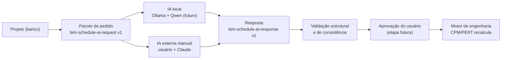

# Integração com IA — estrutura preparada

Estado: **preparação arquitetural**. Nenhuma análise de IA é executada nesta versão. Nenhum modelo foi baixado e nenhuma API externa é consumida.

## 1. Princípio



A IA **propõe** metodologias, durações (otimista, mais provável, pessimista), novas atividades, sequências, riscos e premissas. **Quem calcula** datas, caminho crítico, folgas e simulações é sempre o motor (`app/engine`). Trocar a IA não altera o motor.

## 2. Formato de intercâmbio (v1)

Definido em `backend/app/modules/ai/exchange.py` (Pydantic). O JSON Schema está disponível em:

- `GET /api/v1/ai/schema/request`
- `GET /api/v1/ai/schema/response`

**Pedido** (`bim-schedule-ai-request`): cabeçalho (`package_id`, data, versão do gerador), projeto (incluindo `location` e `target_duration_days`), EAP, atividades, precedências, resumo dos modelos IFC (contagem por tipo e pavimentos), `budget` reservado para o importador de orçamento, instruções e contrato de resposta.

**Resposta** (`bim-schedule-ai-response`):

| Campo | Conteúdo |
|---|---|
| `provider` | `ollama`, `manual-claude`, `manual-other` ou `legacy-demo` |
| `methodology_proposals[]` | título, descrição, justificativa, premissas |
| `activities_updates[]` | `id` de atividade existente, `optimistic`/`most_likely`/`pessimistic` (≥ 0, o ≤ m ≤ p), `duration_suggestion`, `risk_note` |
| `new_activity_suggestions[]` | código, nome, `wbs_code`, duração estimada, justificativa |
| `sequence_suggestions[]` | predecessora, sucessora, FS/SS/FF/SF, lag |
| `risks[]`, `assumptions[]`, `warnings[]` | |

Campos não previstos são **rejeitados** (`extra="forbid"`), para que um arquivo malformado não passe despercebido. A resposta no formato antigo da demonstração (`activities_updates`, `risks` e `assumptions` sem cabeçalho) é aceita e convertida, com aviso.

## 3. Provedores

Interface comum em `app/modules/ai/providers/base.py`:

```python
class AIProvider(Protocol):
    kind: str
    def status(self) -> ProviderStatus: ...                  # disponibilidade, sem análise
    def analyze(self, request) -> AIResponsePackage | None: ...
```

| Provedor | `status()` | `analyze()` |
|---|---|---|
| `OllamaProvider` | Consulta `GET {OLLAMA_BASE_URL}/api/tags` na própria máquina, com timeout de 2 s. Informa se o Ollama responde e se o modelo configurado (`qwen3.5:4b`, ajustável) está instalado. | **Não implementado** (`ProviderNotImplemented`) |
| `ManualExchangeProvider` | Sempre `manual` | Retorna `None`: a resposta chega por arquivo |

Hardware de referência: RTX 2060 com 6 GB de VRAM e 32 GB de RAM. Um modelo de ~4B parâmetros quantizado em 4 bits (Q4_K_M) ocupa ~2,5–3,5 GB e cabe na GPU. O tamanho de contexto deve ser escolhido considerando a VRAM restante. A escolha final da quantização fica para a etapa de IA, com medição real.

## 4. Fluxo manual com o Claude (implementado até a validação)

1. `GET /api/v1/ai/projects/{id}/request-package` baixa o JSON do projeto.
2. O usuário envia o arquivo ao Claude (Opus 5.5) na interface web, com as instruções que já vêm no pacote.
3. O usuário salva a resposta JSON.
4. `POST /api/v1/ai/projects/{id}/validate-response` devolve `{valid, errors[], warnings[], summary}`.

Ainda falta, para etapa futura: tela no frontend, aplicação das propostas aprovadas com recálculo pelo motor, e histórico e auditoria de decisões.

## 5. Configuração

```
BIM_SCHEDULE_AI_PROVIDER=manual            # none | ollama | manual
BIM_SCHEDULE_OLLAMA_BASE_URL=http://127.0.0.1:11434
BIM_SCHEDULE_OLLAMA_MODEL=qwen3.5:4b
```

## 6. Limites desta etapa

- Sem chamadas a APIs pagas ou externas.
- Sem download ou instalação do Ollama ou de modelos.
- Sem planejamento inteligente, sem aplicação de propostas e sem interface de IA no frontend.
- A demonstração estática mantém sua própria "Central de IA" (intercâmbio JSON local), que não é integrada ao backend.
