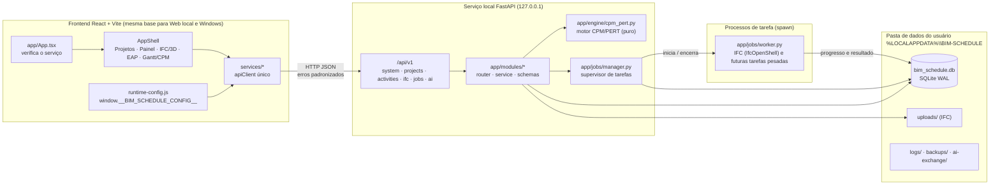
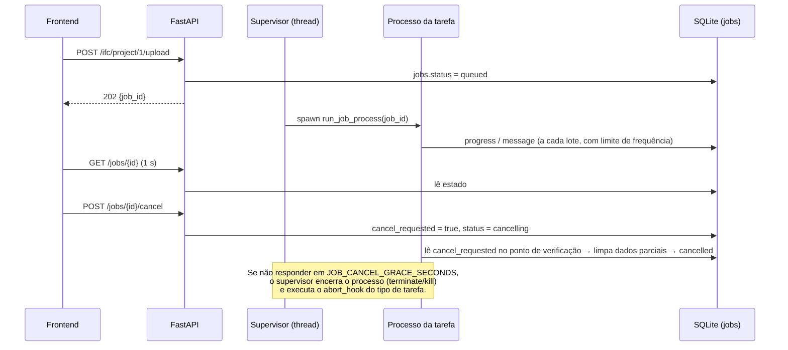

# Arquitetura do BIM SCHEDULE

Versão de referência: **0.6.0-dev** (Etapa 2 — reestruturação da arquitetura).

Este documento descreve a arquitetura **implementada** e o que está apenas **preparado**.
Itens marcados como _preparado_ têm estrutura e contrato definidos, mas não são funcionalidades prontas.

## 1. Visão geral



Princípios:

1. **O motor de engenharia é independente** (`app/engine`). Ele não conhece HTTP, banco ou IA. Datas, CPM, folgas e caminho crítico são sempre calculados por ele.
2. **A IA apenas propõe.** Propostas chegam pelo formato de intercâmbio (`app/modules/ai/exchange.py`) e são validadas. A aplicação delas ao cronograma é escopo de etapa futura.
3. **Operações pesadas não rodam no processo da API.** Elas rodam em processos separados, com progresso persistido e cancelamento cooperativo.
4. **Os dados do usuário nunca são apagados por atualizações.** Migrações fazem backup, e a mudança de pasta é feita por cópia validada.

## 2. Backend

```
backend/app/
  __main__.py            python -m app  (serve | prepare | storage-info)
  main.py                create_app(): middlewares, erros, rotas, ciclo de vida
  api/v1/api.py          agregador de rotas (/api/v1/...)
  core/
    config.py            Settings (prefixo BIM_SCHEDULE_), leitura sob demanda
    storage.py           pasta de dados + migração validada de dados legados
    database.py          engine/sessão; SQLite com WAL, foreign_keys e busy_timeout
    schema_migrations.py Alembic na inicialização, com backup prévio do banco
    bootstrap.py         sequência de inicialização/encerramento
    runtime.py           estado do serviço (settings, storage, jobs)
    errors.py            formato padronizado de erros
    security.py          request id, token local, CORS restrito, TrustedHost
    logging.py           console + arquivo rotativo (logs/bim-schedule.log)
  engine/cpm_pert.py     motor CPM/PERT (inalterado nesta etapa)
  jobs/                  manager (supervisor), worker (processo filho), context, registry, router
  models/                tabelas SQLAlchemy (projetos, EAP, atividades, IFC, jobs)
  modules/
    projects/            router · service · schemas            — disponível
    planning/            router · service · schemas (EAP/CPM)  — disponível
    ifc/                 router · service · parser · jobs      — experimental
    system/              saúde, estado e capacidades reais
    ai/                  exchange · providers · service · router — preparado
    budget/              importação de orçamento               — preparado (sem código)
    simulation/          simulação 4D                          — preparado (sem código)
    reports/             relatórios e exportações              — preparado (sem código)
```

Cada módulo pode ser desenvolvido e testado separadamente. As rotas HTTP chamam os serviços, e os serviços usam os modelos e o motor. Os prefixos de rota anteriores foram mantidos (`/projects`, `/activities`, `/ifc`), para que o frontend e os testes existentes continuem válidos.

### 2.1 Comunicação frontend ↔ backend

| Aspecto | Implementação |
|---|---|
| Transporte | HTTP/JSON em `http://127.0.0.1:<porta>/api/v1` |
| Endereço no frontend | `runtime-config.js` → `VITE_API_BASE_URL` → `/api/v1` (proxy do Vite) |
| Validação | Pydantic nas entradas, com 422 e lista de campos inválidos |
| Erros | `{"error": {code, message, details, request_id}, "detail": message}` |
| Rastreabilidade | cabeçalho `X-Request-ID` em toda resposta e nos logs |
| Tarefas demoradas | `202 Accepted` + `job_id`; `GET /jobs/{id}`; `POST /jobs/{id}/cancel` |
| Progresso | o frontend consulta a tarefa a cada 1 s (`useJobProgress`) |
| Disponibilidade | `GET /system/health` (leve) e `GET /system/status` (versão, banco, pasta de dados, capacidades) |
| Indisponibilidade | o frontend diferencia erro de rede, tempo esgotado, cancelamento e erro HTTP (`ApiError.kind`) |
| Cancelamento no cliente | toda chamada aceita `AbortSignal` |

### 2.2 Tarefas em segundo plano

Cada tarefa roda em **um processo próprio**, criado com `multiprocessing` no modo `spawn`, que é o único disponível no Windows e é usado em todos os sistemas para manter o mesmo comportamento.



- **Estados:** `queued`, `running`, `cancelling`, `completed`, `failed`, `cancelled` e `interrupted`.
- **Persistência:** a tabela `jobs` guarda status, progresso, mensagem, erro, resultado e PID.
- **Recuperação:** tarefas ativas encontradas na inicialização pertenciam a um serviço que terminou. Elas são marcadas `interrupted`, e o `abort_hook` corrige o estado do domínio (por exemplo, o modelo IFC volta a `failed`, sem elementos parciais).
- **Falhas:** uma exceção na tarefa fica registrada com a mensagem. Morte abrupta do processo é detectada pelo código de saída.
- **Encerramento do serviço:** o serviço pede o cancelamento das tarefas em execução, aguarda o prazo e encerra os processos restantes.
- **Concorrência:** `JOB_MAX_WORKERS` (padrão 1) define quantos processos rodam ao mesmo tempo, já que o processamento IFC consome muita memória.
- **Particularidade do `spawn`:** o processo filho reimporta o módulo principal. Por isso o ponto de entrada precisa de `if __name__ == "__main__":`, e no executável empacotado também de `multiprocessing.freeze_support()`, que já está em `app/__main__.py`. Scripts próprios que usem `JobManager` precisam seguir a mesma regra.
- **Sem Celery ou Redis:** o serviço é local e de um único usuário, então uma fila distribuída seria complexidade sem benefício.

### 2.3 Pasta de dados e preservação

| Item | Local |
|---|---|
| Windows | `%LOCALAPPDATA%\BIM-SCHEDULE` |
| Linux | `$XDG_DATA_HOME/bim-schedule` (ou `~/.local/share/bim-schedule`) |
| macOS | `~/Library/Application Support/BIM-SCHEDULE` |
| Personalizado | `BIM_SCHEDULE_DATA_DIR` ou `python -m app --data-dir ...` |

**Migração da instalação anterior** (`backend/bim_schedule.db` e `backend/uploads`), executada uma única vez:

1. Ocorre somente se a nova pasta ainda não tem banco e existem dados legados.
2. Copia o banco com a API de backup do SQLite, abrindo a origem somente para leitura, para uma pasta temporária.
3. Confere `PRAGMA integrity_check` e a contagem de registros de todas as tabelas (origem e cópia).
4. Copia cada IFC e confere o SHA-256.
5. Reescreve os caminhos dos IFC na cópia do banco.
6. Só então ativa a nova pasta e grava `migration-report.json`.
7. **Os arquivos originais nunca são alterados nem apagados.**
8. Em qualquer falha, a cópia temporária é descartada e o serviço **continua usando o local legado**. O estado aparece em `/system/status` (`storage.mode = "legacy"`).

**Migrações de esquema:** antes de cada atualização Alembic, o banco é copiado para `backups/bim_schedule-<data>-antes-<revisão>.db`. As migrações são aditivas, e os `downgrade` não removem dados.

### 2.4 Segurança do serviço local

- O serviço escuta **somente em 127.0.0.1**. `python -m app` recusa outros endereços.
- `TrustedHostMiddleware` aceita apenas `127.0.0.1`, `localhost` e `::1` no cabeçalho Host, o que protege contra *DNS rebinding*.
- O CORS libera apenas as origens configuradas (comparação exata, sem credenciais). A origem `null` de páginas `file://` nunca é autorizada; o app Windows usa a origem `app://bim-schedule`.
- O token local é opcional (`BIM_SCHEDULE_LOCAL_API_TOKEN`). Quando definido, toda rota `/api` exige o cabeçalho `X-BIM-Schedule-Token`, exceto `/system/health`. O app Windows deverá gerar um token por sessão.
- **Uploads:** só arquivos `.ifc`, com limite de tamanho. O nome é sanitizado e o arquivo fica sempre dentro de `uploads/`. Arquivos parciais são removidos em caso de erro.
- Erros internos retornam mensagem genérica com `request_id`, e o detalhe vai só para o log.

## 3. Frontend

```
frontend/src/
  main.tsx
  app/App.tsx            verifica o serviço; tela de indisponibilidade; aviso de perda de conexão
  app/AppShell.tsx       barra lateral, barra superior e módulo ativo (antigo LegacyApp)
  config/runtime.ts      configuração em tempo de execução
  services/              apiClient (único uso de axios) + projects, planning, ifc, jobs, system
  hooks/                 useBackendStatus, useJobProgress
  components/            Navbar, Sidebar, ProjectModal
  components/feedback/   LoadingState, ErrorState, EmptyState, Notice, BackendUnavailable, JobProgressCard
  modules/               projects, dashboard, bim3d, wbs, gantt
  types/                 project.ts, api.ts
public/
  runtime-config.js      configuração em tempo de execução (não compilada)
  demo.html, schedule-enhancements.js   demonstração estática (referência; dados fictícios)
```

- Existe **uma aplicação principal**. O parâmetro `?connected=1` e o iframe foram removidos.
- **Sem serviço:** o app mostra orientação para iniciá-lo e um link para a demonstração, identificada como "dados fictícios". Nenhum dado simulado aparece na aplicação principal.
- **Configuração em tempo de execução:** o app Windows serve um `runtime-config.js` gerado na hora, que define `window.__BIM_SCHEDULE_CONFIG__ = { apiBaseUrl, apiToken, mode }`, **sem recompilar o frontend**.
- O build usa `base: './'`, então funciona no servidor Vite, em subpastas e sob o protocolo próprio `app://bim-schedule` do Electron.

## 4. Estratégia para Web

| Cenário | Frontend | Backend | Estado |
|---|---|---|---|
| **GitHub Pages** | Somente a demonstração estática (raiz do site) | Nenhum | Implementado. A aplicação React não é publicada no Pages porque depende do serviço. |
| **Web local** (atual) | Vite em `127.0.0.1:3000` (`start.bat`) | Serviço local `127.0.0.1:8000` | Implementado |
| **Web com backend remoto** (futuro) | Build estático com `VITE_API_BASE_URL=https://api...` ou `runtime-config.js` do servidor | FastAPI hospedado | Preparado. Exige autenticação de usuários, banco multiusuário (PostgreSQL), armazenamento de arquivos, `ENVIRONMENT=server`, `ALLOWED_HOSTS` e `CORS_ORIGINS` do domínio, e HTTPS. Nada disso está implementado. |

O GitHub Pages **não executa** Python. Nenhuma funcionalidade do serviço está disponível na página publicada.

## 5. Estratégia para Windows

Resumo (detalhes em [`WINDOWS_DESKTOP.md`](WINDOWS_DESKTOP.md)):

- **Electron** como casca do app, carregando o mesmo build do frontend.
- O backend é empacotado com **PyInstaller** (modo pasta) e iniciado pelo Electron como processo filho: `bim-schedule-service --port 0`. O serviço imprime `BIM_SCHEDULE_READY {"api_base_url": ...}`. O Electron lê essa linha, consulta `/system/health` e encerra o serviço ao fechar.
- A interface é carregada pelo **protocolo privilegiado `app://bim-schedule`**, e não por `loadFile()`. Com `file://`, a origem seria `null`, que o CORS do serviço não aceita e não deve aceitar. O Electron autoriza só a origem exata (`BIM_SCHEDULE_CORS_ORIGINS=["app://bim-schedule"]`) e entrega `apiBaseUrl` e `apiToken` em um `runtime-config.js` gerado pelo handler do protocolo. Detalhes e alternativas avaliadas: `WINDOWS_DESKTOP.md`, seção 3.1.
- O usuário não abre terminal.
- O funcionamento **offline** ainda não foi validado e não está prometido. Hoje a demonstração carrega fontes e bibliotecas por CDN. A aplicação React não usa CDN, mas o pacote Windows ainda não existe para ser testado offline.

## 6. Preparação para IA

Detalhes em [`AI_INTEGRATION.md`](AI_INTEGRATION.md).

- Formato comum `bim-schedule-ai-request` / `bim-schedule-ai-response` (v1), com JSON Schema em `/api/v1/ai/schema/{request|response}`.
- Interface `AIProvider`, com dois provedores:
  - **Ollama:** só verificação de disponibilidade, sem análise e sem download de modelos.
  - **Manual (Claude):** exporta o pacote e valida o arquivo de retorno.
- A validação confere estrutura, ordem PERT (o ≤ m ≤ p) e se as atividades citadas pertencem ao projeto. **Nada é aplicado ao cronograma.**
- Trocar de IA não altera o motor de engenharia.

## 7. Testes

| Conjunto | Ferramenta | Comando |
|---|---|---|
| Backend: CPM/PERT, API, tarefas, IFC real, migração de dados, persistência com reinício do serviço, erros e segurança, IA | pytest | `cd backend && python -m pytest -q` |
| Frontend: configuração e cliente da API | Vitest | `cd frontend && npm run test:unit` |
| Motor da demonstração | node:test | `cd frontend && npm run test:schedule` |
| Ponta a ponta: serviço real + interface | Playwright | `cd frontend && npx playwright install chromium && npm run test:e2e` |
| CI | GitHub Actions | `.github/workflows/ci.yml` (backend em Ubuntu e Windows, frontend e e2e) |

No Windows, os testes e2e usam `python` do PATH. Defina `BIM_SCHEDULE_PYTHON` para usar outro interpretador, por exemplo `..\.venv\Scripts\python.exe`.
