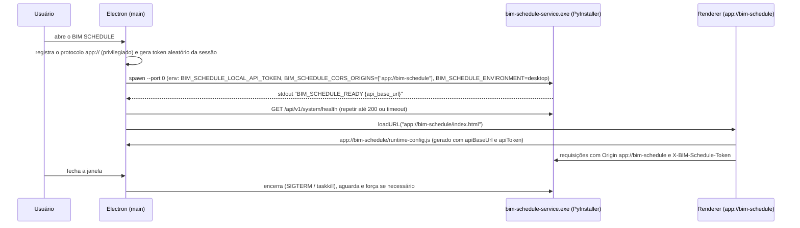

# Aplicativo Windows — avaliação e estratégia

Estado: **casca Electron implementada na Etapa 4** (`desktop/`, ver `docs/reports/ETAPA-04-DESKTOP.md` e `docs/TUTORIAL-DESKTOP.md`). Distribuição como pasta (`win-unpacked`); instalador NSIS configurado (`npm run dist:installer`), mas ainda não validado. Assinatura de código e atualização automática continuam pendentes.

## 1. Requisitos

- Uma única base de frontend para Web e Windows.
- O serviço local (Python/FastAPI, IfcOpenShell) deve iniciar e parar junto com o app, sem terminal.
- Hardware de referência: 32 GB de RAM, RTX 2060 (6 GB de VRAM), Windows.
- Funcionamento offline é preferencial. Ainda **não está validado**.
- Futuro: Ollama local (processo separado, gerenciado pelo próprio Ollama).

## 2. Alternativas avaliadas

| Critério | **Electron** | Tauri 2 | PyWebView | Navegador + serviço (sem casca) |
|---|---|---|---|---|
| Reuso do frontend React/Vite | Total | Total | Total | Total |
| Motor de renderização / WebGL (IFC 3D) | Chromium embutido: versão fixa e previsível | WebView2 do sistema (Chromium/Edge): depende da versão instalada | WebView2 | Navegador do usuário |
| Gerência do processo Python | Node `child_process`: simples, em TypeScript | "sidecar" em Rust: bom, mas exige Rust | O próprio Python é o app | Script `.bat` ou serviço do Windows |
| Linguagens novas para a equipe | Nenhuma (TS/JS) | Rust | Nenhuma | Nenhuma |
| Tamanho do instalador | Maior (~90–150 MB de Chromium) | Menor (~5–15 MB) | Pequeno | Mínimo |
| Atualização automática | electron-updater (maduro) | Plugin updater (maduro) | Manual | Manual |
| Riscos | Tamanho e memória | WebView2 ausente ou desatualizado em máquinas corporativas; curva de Rust | Menos recursos de casca; empacotamento mais frágil | Experiência de "site", portas visíveis ao usuário |

**Recomendação: Electron.** O motivo decisivo é a previsibilidade do WebGL e do WebAssembly para o visualizador IFC, com Chromium fixo e testável. A equipe também não precisa adotar Rust. O tamanho extra (~100 MB) é pequeno perto do serviço Python com IfcOpenShell (~150–250 MB) e de um modelo Qwen de 4B (~2,5–3,5 GB). O Tauri continua sendo a alternativa, caso o tamanho do instalador se torne prioridade.

## 3. Arquitetura proposta

### 3.1 Origem da interface e CORS (por que não usar `loadFile()`)

Uma página aberta com `BrowserWindow.loadFile()` usa o esquema `file://`, e o Chromium envia o cabeçalho `Origin: null` nas requisições para outra origem. O serviço local aceita apenas as origens listadas em `CORS_ORIGINS` (`backend/app/core/security.py`), e `null` **não** deve ser incluída: é a mesma origem usada por iframes com `sandbox`, documentos `data:` e qualquer arquivo local aberto no navegador, então liberá-la abriria a API para conteúdo não confiável. Desligar `webSecurity` ou liberar `*` também está fora de questão.

Alternativas avaliadas:

| Opção | Origem vista pelo serviço | CORS | Avaliação |
|---|---|---|---|
| `loadFile()` (`file://`) | `null` | Exigiria liberar `null` | **Rejeitada** (insegura) |
| `webSecurity: false` | — | Desligado | **Rejeitada** (desliga a política de mesma origem) |
| **Protocolo próprio `app://bim-schedule`** registrado como privilegiado (*standard*, *secure*) | `app://bim-schedule` | Uma única origem exata adicionada pelo Electron | **Recomendada** |
| Servidor HTTP local do Electron (`http://127.0.0.1:<porta>`) para os arquivos do frontend | `http://127.0.0.1:<porta>` | Uma origem exata | Viável, porém abre mais uma porta acessível a qualquer processo local; sem vantagem sobre o protocolo próprio |
| O próprio serviço FastAPI serve o frontend (mesma origem) | igual à da API | Dispensado | Viável, mas a interface passa a depender do serviço para abrir: a tela "serviço indisponível" não seria exibida, e falhas de inicialização exigiriam uma tela separada no Electron. Fica como alternativa. |

**Solução recomendada: protocolo `app://` privilegiado**

1. Antes de `app.ready`, registrar o esquema:
   ```js
   protocol.registerSchemesAsPrivileged([{
     scheme: 'app',
     privileges: { standard: true, secure: true, supportFetchAPI: true, corsEnabled: true },
   }]);
   ```
   Como esquema *standard*, as páginas carregadas por ele têm origem própria, `app://bim-schedule`, em vez de `null`. Como *secure*, o contexto é seguro, assim como em HTTPS.
2. Em `app.whenReady()`, `protocol.handle('app', handler)` serve os arquivos de `dist/` (o build do Vite):
   - aceita apenas o host `bim-schedule`;
   - resolve o caminho e **recusa qualquer caminho fora de `dist/`** (proteção contra `..`);
   - devolve o `Content-Type` correto, em especial `application/wasm` para os arquivos do web-ifc;
   - gera dinamicamente `app://bim-schedule/runtime-config.js` com `apiBaseUrl` e `apiToken` da sessão. O frontend já lê esse arquivo antes de iniciar (`public/runtime-config.js`), então **nenhuma recompilação nem preload** é necessária para informar o endereço do serviço.
3. O Electron inicia o serviço com a origem exata autorizada:
   `BIM_SCHEDULE_CORS_ORIGINS=["app://bim-schedule"]` (JSON), além de `BIM_SCHEDULE_LOCAL_API_TOKEN` e `BIM_SCHEDULE_ENVIRONMENT=desktop`. A lista padrão de origens do Vite não é usada no app empacotado.
4. A janela é aberta com `win.loadURL('app://bim-schedule/index.html')` e mantém os padrões seguros: `contextIsolation: true`, `sandbox: true`, `nodeIntegration: false`, `webSecurity: true`. Navegação para outras origens é bloqueada (`will-navigate`, `setWindowOpenHandler`). Links externos, como a demonstração, abrem no navegador do sistema.

Por que funciona com o código atual:
- O CORS do serviço compara a origem de forma **exata**. `app://bim-schedule` entra por configuração, sem curingas. O teste `test_cors_accepts_desktop_protocol_origin_only_when_configured` comprova que essa origem é aceita quando configurada e que `null` continua recusada.
- Requisições com o cabeçalho `X-BIM-Schedule-Token` geram *preflight*. O serviço já permite esse cabeçalho (`allow_headers`), sem credenciais (`allow_credentials=False`).
- `TrustedHostMiddleware` continua aceitando apenas `127.0.0.1`, `localhost` e `::1` no cabeçalho Host, que é o destino das requisições, e não depende da origem da página.
- A página em `app://` (contexto seguro) pode chamar `http://127.0.0.1:<porta>`, porque o Chromium trata `127.0.0.1` como origem potencialmente confiável. Não há bloqueio de conteúdo misto.
- O build usa `base: './'`, então os caminhos relativos funcionam sob `app://bim-schedule/`.
- O visualizador IFC baixa o modelo pela API com o token (`setRequestHeader`) e carrega o WASM de `./web-ifc.wasm`, servido pelo protocolo.

Precisa ser validado quando a casca Electron for implementada: carregamento do WASM com o tipo `application/wasm`, *preflight* do download do IFC e o teste e2e rodando contra o app empacotado.

### 3.2 Sequência de inicialização



### 3.3 O que já está pronto no código

| Necessidade | Implementação |
|---|---|
| Comando único do serviço | `python -m app` (`backend/app/__main__.py`) |
| Porta livre automática | `--port 0` |
| Sinal de pronto | linha `BIM_SCHEDULE_READY {"api_base_url": ...}` no stdout, seguida de `/api/v1/system/health` |
| Endereço sem recompilar | `runtime-config.js` lido antes da aplicação (gerado pelo handler do protocolo `app://`) |
| Origem autorizada no CORS | `BIM_SCHEDULE_CORS_ORIGINS` (lista exata; `null` nunca incluída) |
| Token por sessão | `BIM_SCHEDULE_LOCAL_API_TOKEN` + cabeçalho `X-BIM-Schedule-Token` |
| Somente local | recusa `--host` diferente de 127.0.0.1/localhost |
| Pasta de dados | `%LOCALAPPDATA%\BIM-SCHEDULE` com migração validada |
| Processos filhos no executável | `multiprocessing.freeze_support()` no ponto de entrada |
| Caminhos relativos | `vite.config.ts` com `base: './'` (funciona sob `app://bim-schedule/`) |
| Encerramento limpo | lifespan do FastAPI cancela tarefas e encerra processos filhos |

## 4. Pontos a resolver na etapa de distribuição

1. **PyInstaller.** Incluir `backend/migrations` e `alembic.ini` como dados. Hoje são localizados por `BACKEND_DIR`; no executável será preciso usar `sys._MEIPASS`. Incluir também os binários do IfcOpenShell e testar `spawn` dentro do executável.
2. **Encerramento no Windows.** `process.kill()` do Node não propaga sinais. Usar `taskkill /PID <pid> /T` para encerrar a árvore de processos, incluindo os processos de tarefa. O serviço já trata o encerramento pelo lifespan, mas a morte forçada do pai precisa ser testada.
3. **Antivírus e SmartScreen.** Executáveis PyInstaller sem assinatura costumam ser bloqueados. Prever assinatura de código.
4. **Offline.** Validar sem rede: fontes (a aplicação React não usa CDN; a demonstração usa), WASM do web-ifc (copiado para `public/` no `postinstall`), sem consulta ao Open-Meteo.
5. **Ollama.** Instalação separada, oficial. O app só detecta (`/api/v1/ai/providers/ollama/status`) e orienta. Não deve embutir modelos no instalador.
6. **Logs e suporte.** Os logs ficam em `%LOCALAPPDATA%\BIM-SCHEDULE\logs`. O app deve oferecer "abrir pasta de logs".

## 5. Fora do escopo da Etapa 2

Instalador (NSIS ou MSIX), casca Electron (incluindo o handler do protocolo `app://`), assinatura de código, atualização automática, testes offline e testes com o executável empacotado.
