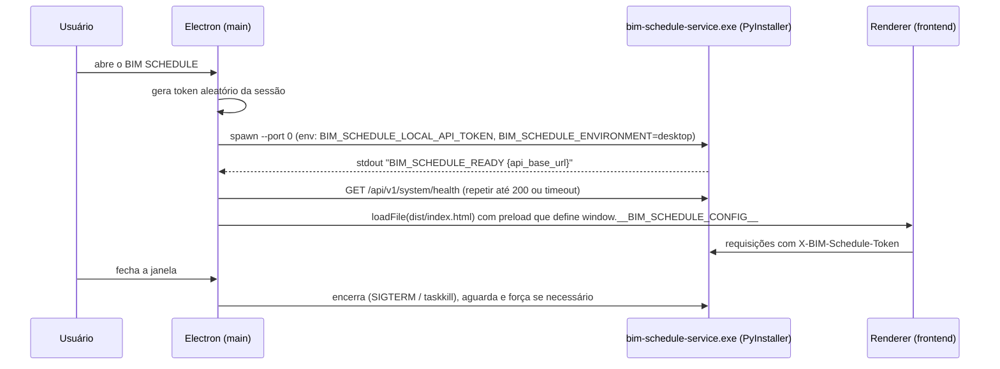

# Aplicativo Windows — avaliação e estratégia

Estado: **somente estratégia documentada**. O instalador e a casca desktop **não** foram implementados na Etapa 2.

## 1. Requisitos

- Uma única base de frontend para Web e Windows.
- O serviço local (Python/FastAPI, IfcOpenShell) deve iniciar e parar junto com o app, sem terminal.
- Hardware de referência: 32 GB de RAM, RTX 2060 (6 GB de VRAM), Windows.
- Funcionamento offline é preferencial. Ainda **não está validado**.
- Futuro: Ollama local (processo separado, gerenciado pelo próprio Ollama).

## 2. Alternativas avaliadas

| Critério | **Electron** | Tauri 2 | PyWebView | Navegador + serviço (sem casca) |
|---|---|---|---|---|
| Reuso do frontend React/Vite | Total | Total | Total | Total |
| Motor de renderização / WebGL (IFC 3D) | Chromium embutido: versão fixa e previsível | WebView2 do sistema (Chromium/Edge): depende da versão instalada | WebView2 | Navegador do usuário |
| Gerência do processo Python | Node `child_process`: simples, em TypeScript | "sidecar" em Rust: bom, mas exige Rust | O próprio Python é o app | Script `.bat` ou serviço do Windows |
| Linguagens novas para a equipe | Nenhuma (TS/JS) | Rust | Nenhuma | Nenhuma |
| Tamanho do instalador | Maior (~90–150 MB de Chromium) | Menor (~5–15 MB) | Pequeno | Mínimo |
| Atualização automática | electron-updater (maduro) | Plugin updater (maduro) | Manual | Manual |
| Riscos | Tamanho e memória | WebView2 ausente ou desatualizado em máquinas corporativas; curva de Rust | Menos recursos de casca; empacotamento mais frágil | Experiência de "site", portas visíveis ao usuário |

**Recomendação: Electron.** O motivo decisivo é a previsibilidade do WebGL e do WebAssembly para o visualizador IFC, com Chromium fixo e testável. A equipe também não precisa adotar Rust. O tamanho extra (~100 MB) é pequeno perto do serviço Python com IfcOpenShell (~150–250 MB) e de um modelo Qwen de 4B (~2,5–3,5 GB). O Tauri continua sendo a alternativa, caso o tamanho do instalador se torne prioridade.

## 3. Arquitetura proposta

O que já está pronto no código para essa integração:

| Necessidade | Implementação |
|---|---|
| Comando único do serviço | `python -m app` (`backend/app/__main__.py`) |
| Porta livre automática | `--port 0` |
| Sinal de pronto | linha `BIM_SCHEDULE_READY {"api_base_url": ...}` no stdout, seguida de `/api/v1/system/health` |
| Endereço sem recompilar | `window.__BIM_SCHEDULE_CONFIG__` (preload) ou `runtime-config.js` |
| Token por sessão | `BIM_SCHEDULE_LOCAL_API_TOKEN` + cabeçalho `X-BIM-Schedule-Token` |
| Somente local | recusa `--host` diferente de 127.0.0.1/localhost |
| Pasta de dados | `%LOCALAPPDATA%\BIM-SCHEDULE` com migração validada |
| Processos filhos no executável | `multiprocessing.freeze_support()` no ponto de entrada |
| Build relativo para `file://` | `vite.config.ts` com `base: './'` |
| Encerramento limpo | lifespan do FastAPI cancela tarefas e encerra processos filhos |

## 4. Pontos a resolver na etapa de distribuição

1. **PyInstaller.** Incluir `backend/migrations` e `alembic.ini` como dados. Hoje são localizados por `BACKEND_DIR`; no executável será preciso usar `sys._MEIPASS`. Incluir também os binários do IfcOpenShell e testar `spawn` dentro do executável.
2. **Encerramento no Windows.** `process.kill()` do Node não propaga sinais. Usar `taskkill /PID <pid> /T` para encerrar a árvore de processos, incluindo os processos de tarefa. O serviço já trata o encerramento pelo lifespan, mas a morte forçada do pai precisa ser testada.
3. **Antivírus e SmartScreen.** Executáveis PyInstaller sem assinatura costumam ser bloqueados. Prever assinatura de código.
4. **Offline.** Validar sem rede: fontes (a aplicação React não usa CDN; a demonstração usa), WASM do web-ifc (copiado para `public/` no `postinstall`), sem consulta ao Open-Meteo.
5. **Ollama.** Instalação separada, oficial. O app só detecta (`/api/v1/ai/providers/ollama/status`) e orienta. Não deve embutir modelos no instalador.
6. **Logs e suporte.** Os logs ficam em `%LOCALAPPDATA%\BIM-SCHEDULE\logs`. O app deve oferecer "abrir pasta de logs".

## 5. Fora do escopo da Etapa 2

Instalador (NSIS ou MSIX), casca Electron, assinatura de código, atualização automática, testes offline e testes com o executável empacotado.
